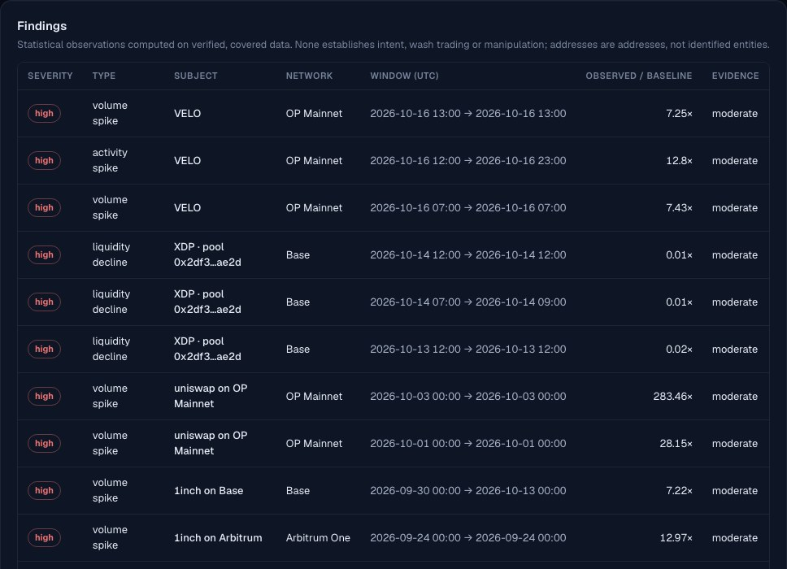

# DeFi Intelligence

**Self-hosted, multi-chain DeFi analytics and anomaly intelligence, with private AI that can only explain verified numbers.**

Homepage → https://wearetheartmakers.github.io/1inch-defi-intelligence/

DeFi Intelligence is independent software. It is not affiliated with or endorsed by any protocol it analyses.
This repository is the **public showcase**: an overview, screenshots and reviewed example results. The application
source is private. The examples below are **precomputed, reviewed snapshots (generated 2026-10-17)**. They are not live
data, and this static page does not connect to any API.

## What it does

| Capability | What it means |
|---|---|
| **Verified multi-chain ingestion** | Public JSON-RPC on Base, Arbitrum One, OP Mainnet and Ethereum through Airflow into ClickHouse. Block coverage is proven per run; empty answers are confirmed by a second provider; timestamps come from block headers; a run is published only when every quality gate passes, idempotently. |
| **Universal token explorer** | Any token contract on a supported network: on-chain identity check plus an independent registry check, pool discovery, decoder support level per pool (supported / partially supported / unsupported), collection of only the missing windows, per-pool coverage, quality checks, anomaly detection and an evidence-backed report. |
| **Receipt-verified decoders** | Uniswap v3-style, Uniswap v2-style and Solidly-style (Velodrome/Aerodrome v2) pools. A family is supported only after ≥ 2 pools on ≥ 2 networks match transaction receipts exactly, including Solidly's fee forwarding. |
| **Anomaly intelligence** | Volume, activity and liquidity shifts against a baseline frozen at onset, plus address concentration, buy/sell imbalance, price-volume divergence and repetitive patterns. Every finding carries facts, method, parameters, limitations and alternative explanations, and none is an accusation. |
| **Honest valuation** | USD comes from a stablecoin leg or a verified hourly price within ±15 minutes. Swaps without a verified price are counted as *unvalued*, never as $0. Pool-event volume and transaction-net volume (routing removed) are reported separately. |
| **Private, model-agnostic AI** | Ollama (tested) or any server exposing an OpenAI-compatible API — vLLM, llama.cpp, LM Studio or an organisation gateway are integration options using the same adapter, which is tested against Ollama's OpenAI-compatible endpoint. Native Anthropic and OpenAI providers are optional and off by default: no paid request is made until an administrator enables the provider and authorises paid use within request, token and budget limits. Every sentence must cite the facts behind its numbers; numbers, terminology and claims are re-checked. A rejected answer falls back to a deterministic, evidence-backed one. |
| **Conversational analyst** | Multi-turn, multilingual conversations (tested in English, Turkish and German). Follow-up questions keep the token and topic of the previous turn, and every turn is re-grounded in its own verified facts. |
| **Operations** | One operations view (service health, pipeline runs and failures, freshness per token, quality audits, backups, alerts), measured storage, verified backups with test-restore, a versioned staging archive, separate restartable Airflow services, preflight resource checks, an audit log, organisations and role-based access. |

## Verified research examples (reviewed snapshots)

**Aggregator volume anomaly on Base** (1inch series, 1 Sep → 15 Oct 2026). This is an audited case: every headline
number was re-derived from 3,293,676 decoded swap events, and 150/150 sampled receipts matched.
- Window volume: **$458.56M**. A single automated account accounted for **90.2%** of it.
- Peak: **10.3×** the pre-onset median.
- Volume excluding the identified account: **−15.5%** against its 14-day baseline. The audit corrected this from
  −20.5% after finding a silently empty provider response.
- These are statistical observations; they do not claim intent.

**ARB on Arbitrum One** (14 Oct 12:00 → 17 Oct 03:00 UTC, 3 ingested Uniswap v3 pools):
- 63,089 pool swap events in 62,892 transactions; valued volume $17.06M.
- Valuation: 36.8% of swaps through stablecoin legs, 63.2% through verified hourly prices, 0 unvalued.
- Pass-through routing: 0.1%.

**VELO on OP Mainnet** (16 Oct 12:00 → 17 Oct 00:00 UTC):
- **Pools:** 12 discovered, all receipt-verified and supported; 6 ingested.
- **Contrast:** the Solidly pools carried 62,302 swap events but only 463,647 VELO; the v3 pools carried 3,266 events
  but 12.2 M VELO.
- **Repetitive patterns:** detected and reported as observations, not accusations.
- **Scope:** time coverage of the ingested pools is complete, but the token's market coverage is not. The report says
  so explicitly.

## Screenshots
| | |
|---|---|
|  |  |
|  |  |

## Local model benchmark (reviewed snapshot, 2026-10-17)
Same frozen fact set (10 questions in English, Turkish and German; 8 answered by the model, 2 declined by deterministic
pre-checks), same validators, on a 16 GB laptop:

| Model | Answers accepted by validation | Grounding failures (fell back to deterministic) | Avg latency | Resident memory |
|---|---|---|---|---|
| gemma3:4b | 8 / 8 | 0 | 8.3 s | 2.9 GB |
| qwen3.5:9b | 6 / 8 | 2 | 22.4 s | 5.7 GB |

A benchmark on one machine, not a performance promise; larger models and GPU servers have not been benchmarked yet.

## Deployment profiles
| Profile | Target | Notes |
|---|---|---|
| A — local developer | ~16 GB RAM laptop | Docker Compose, small or medium local models, conservative context, memory guard, hourly ingestion off by default |
| B — business server | Linux, 32–128 GB, optional NVIDIA GPU | TLS reverse proxy only; ClickHouse, Airflow and inference stay internal; several models; separate Airflow services |
| C — enterprise | Kubernetes, large GPUs, separate inference servers | Network policies, external secrets, model serving separate from the API. Horizontal API scaling needs a shared application database. |

These profiles are starting points, not performance promises. Capacity depends on the measured hardware.

## Optional integrations
- **Dune Analytics:** optional and off by default. Keys are stored encrypted on the server and tested with free calls
  only. No workflow depends on it.
- **Remote or enterprise AI endpoints:** receive organisation data only when an administrator authorises them.
- **Anthropic / OpenAI:** off by default; no chargeable request is made until an administrator authorises paid use.

## Limitations
- **Analysed scope:** the networks and decoder families listed above, plus pools that are discovered and ingested.
  Other venues are not counted.
- **Time ranges:** the examples above cover historical, ingested windows; nothing here is live streaming data.
- **Findings:** statistical observations. They never establish intent, manipulation or wash trading, and addresses are
  not identified entities.
- **Local AI quality:** depends on the model. The validators reject ungrounded or forbidden statements but do not
  correct grammar.
- **Multi-tenancy:** organisation isolation is enforced and tested for workspaces, reports, members, tokens, settings
  and audit. Ingested public-chain data is shared platform-wide.

## Access
The application is self-hosted. For licensing or evaluation, contact the maintainers through this repository.
