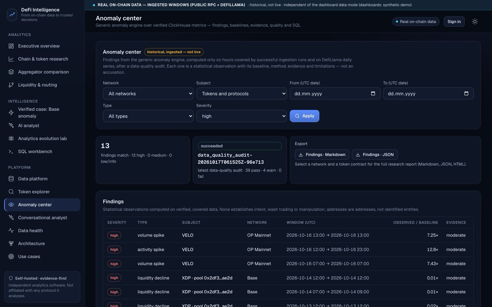
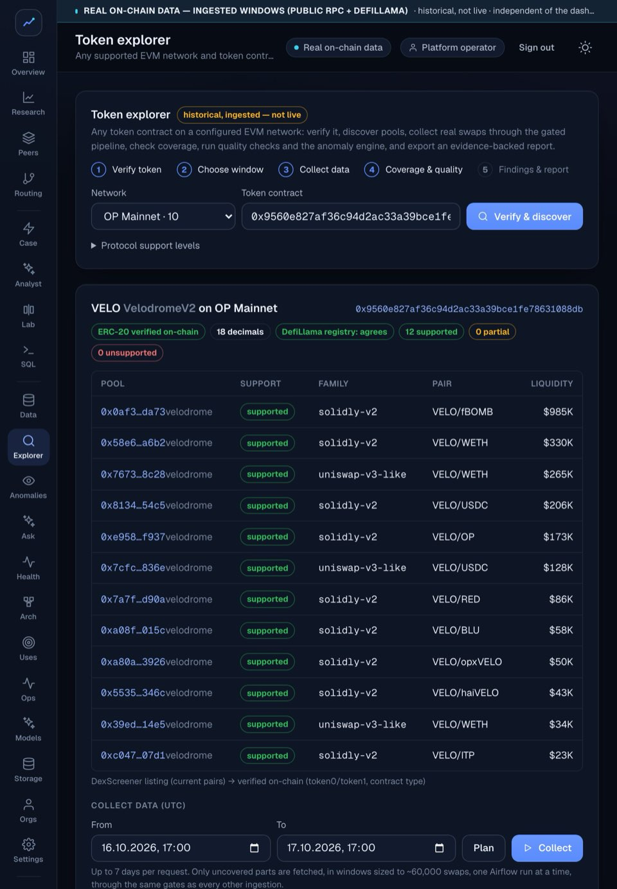
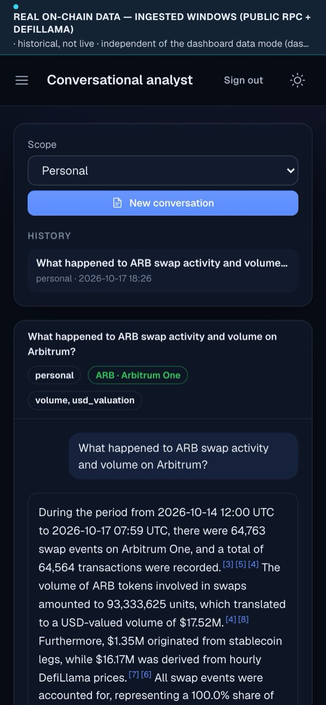
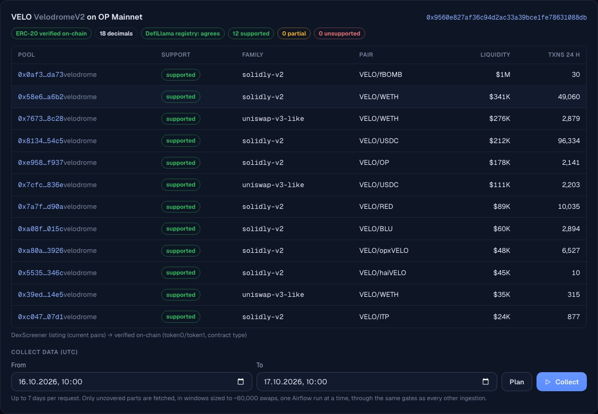
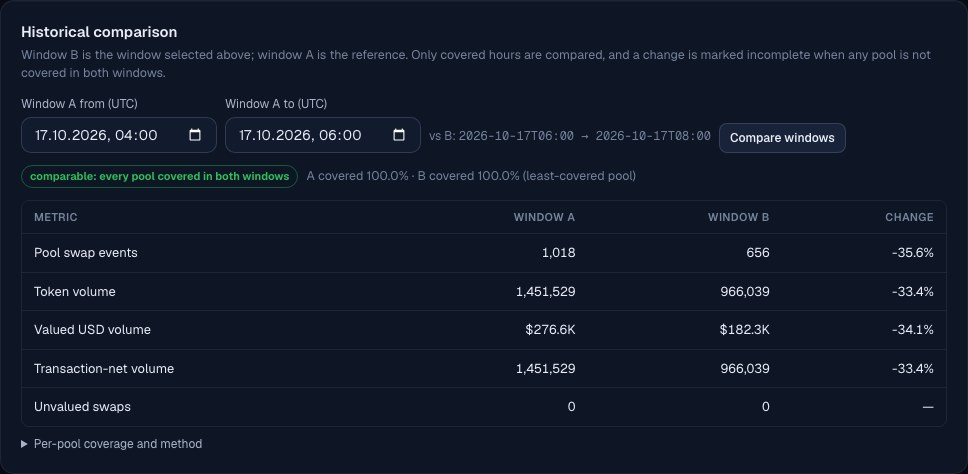
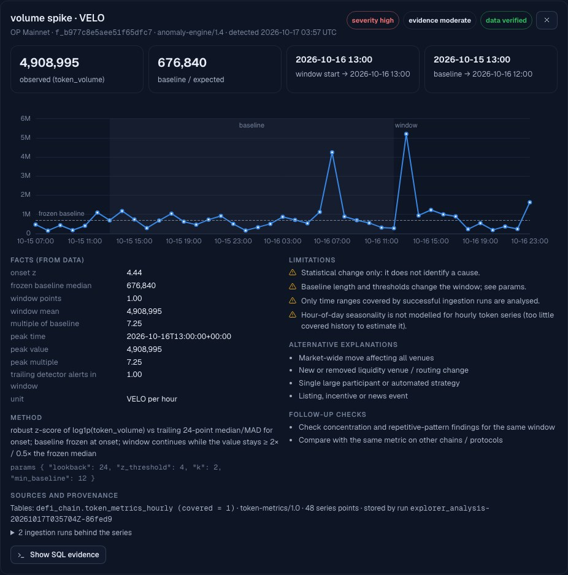

# WATAM DeFi Intelligence

**Private On-Chain Analytics & AI Intelligence — your infrastructure, your blockchain data, verifiable intelligence.**

Homepage → https://wearetheartmakers.github.io/defi-intelligence/ · **[Discuss a pilot](mailto:admin@wearetheartmakers.com?subject=WATAM%20DeFi%20Intelligence%20%E2%80%94%20Pilot%20scoping%20conversation&body=Organisation%3A%0AContact%20person%3A%0ABusiness%20email%3A%0AWhat%20you%20would%20like%20to%20analyse%20%28networks%2C%20tokens%2C%20protocols%29%3A%0APreferred%20deployment%20%28your%20own%20server%20%2F%20private%20cloud%29%3A%0APreferred%20AI%20%28local%20models%20%2F%20your%20own%20cloud%20AI%20account%20%2F%20none%29%3A%0ATimeline%3A%0A%0A%28Please%20do%20not%20include%20confidential%20datasets%2C%20API%20credentials%2C%20private%20keys%20or%20passwords.%29%0A)**

WATAM DeFi Intelligence is analytics software by WATAM — We Are The Art Makers. It runs on your own servers: it reads
swaps from the blockchain, proves the data is complete before using it, flags unusual activity with the evidence
attached, produces source-backed reports, and lets you ask an AI analyst that only states numbers it can trace to
verified facts.

This repository is the **public showcase**: an overview, screenshots and reviewed example results. The application
source is private. The examples below are **reviewed, historical snapshots (October 2026)**, recomputed from the stored
data before publication. They are not live or streaming data, and this static page does not connect to any API.

WATAM DeFi Intelligence is independent software. It is not affiliated with or endorsed by any protocol, token issuer,
network or data provider it analyses; their names are trademarks of their respective owners.

*A responsive web application (desktop, tablet and phone browsers), self-hosted on your own server — not a native mobile
app. The screenshots (17 Oct 2026) predate the WATAM product name.*

## Who it is for
- **Protocols, DAOs and token teams:** how your token trades across chains and pools, with unusual activity flagged
  against its baseline and the evidence attached.
- **Funds and research desks:** source-backed token and protocol research; every figure carries its coverage,
  valuation method and SQL.
- **Risk and market-integrity analytics:** anomaly findings for investigation triage, as statistical observations with
  limitations, never accusations.
- **Analytics consultancies:** client-ready reports from verified data on private infrastructure.

## How it works
1. **Verified data:** swaps from public JSON-RPC (or your own endpoints), proven complete per block range,
   cross-checked, and published to ClickHouse only after quality gates pass.
2. **Analytics and findings:** covered-hour metrics, window comparisons, an anomaly engine with frozen baselines, and
   reports that state exactly what they cover.
3. **Evidence-grounded AI:** answers cite the verified facts of each question. Numbers, terminology and claims are
   re-checked, and anything unproven is replaced by a clearly labelled deterministic answer.

## What it does

| Capability | What it means |
|---|---|
| **Verified multi-chain ingestion** | Public JSON-RPC (or your own endpoints) on Base, Arbitrum One, OP Mainnet and Ethereum through Airflow into ClickHouse. Block coverage is proven per run; empty answers are confirmed by a second provider; a run is published only when every quality gate passes. |
| **Universal token explorer** | Any token contract on a supported network: on-chain identity check plus an independent registry check, pool discovery, a support level per pool, collection of only the missing windows, per-pool coverage, quality checks, anomaly detection and an evidence-backed report. |
| **Receipt-verified decoders** | Uniswap v3-style, Uniswap v2-style and Solidly-style (Velodrome/Aerodrome v2) pools, supported only after decoded swaps matched transaction receipts exactly on several networks. **Uniswap v4** is verified pool by pool: six Ethereum pools are individually verified; other v4 pools are not supported. |
| **Anomaly intelligence** | Volume, activity and liquidity shifts against a baseline frozen at onset, plus concentration, buy/sell imbalance, divergence and repetitive patterns. Every finding carries facts, method, parameters, limitations and alternative explanations; none is an accusation. |
| **Honest valuation** | USD comes from a stablecoin leg or a verified hourly price. Swaps without a verified price stay *unvalued*, never $0. Pool-event volume and transaction-net volume are reported separately. |
| **AI options** | **Local models via Ollama** (tested on one machine). **Anthropic Claude API** and **OpenAI API** with your own account (integrated; optional and off by default; live calls not yet verified). **Self-hosted OpenAI-compatible servers** such as vLLM or llama.cpp (integration option; GPU serving not yet verified). |
| **Security** | Every API route requires sign-in by default; organisation roles; personal API tokens with single-use invitations for onboarding; a sandboxed query engine that blocks file, network and extension access. |
| **Operations and recovery** | Operations view, quality audits, an audit log, and encrypted backups that can be restore-verified on a separate, isolated server without touching production data. |

## Verified research examples (historical snapshots)

**ARB on Arbitrum One** — 14 Oct 2026 12:00 → 17 Oct 2026 08:00 UTC, 4 ingested Uniswap v3-style pools:
- **64,763** pool Swap events; **68 / 68** hours covered by successful, gated ingestion runs.
- **$17.52M** USD-valued pool-event volume: $1.35M through stablecoin legs (23,700 swaps) and $16.17M through verified
  hourly prices (41,063 swaps); **0 unvalued**.
- Pools: WETH/ARB 0.05% (40,956 events), ARB/USDC 0.05% (18,586), ARB/USDC 0.3% (5,114), WETH/ARB 0.3% (107, all
  after 17 Oct 04:00 UTC).
- Selected-pool event measurements: not the total ARB market and not transaction-net trading volume.

**VELO on OP Mainnet** — 16 Oct 2026 12:00 → 17 Oct 2026 00:00 UTC:
- **12** pools discovered, verified on-chain and classified as supported; **6** ingested (3 Solidly-style, 3 Uniswap
  v3-style), 12 / 12 hours covered.
- **65,568** pool Swap events and 12.68M VELO: the Solidly-style pools carried 62,302 events but only 463,647 VELO; the
  v3-style pools carried 3,266 events and 12.2M VELO.
- **$468,893** USD-valued; 1,202 swaps stay unvalued because one hourly price was missing — never counted as $0.
- **3 high-severity findings:** volume spikes of 7.25× and 7.43× and an activity spike of 12.8× against a frozen
  baseline — statistical observations with stated limitations and alternative explanations.
- Market coverage is partial, and the report says so.

## Screenshots
Real screens from the self-hosted web application on verified, historical on-chain data (snapshot 17 Oct 2026).

| | |
|---|---|
|  |  |
|  |  |
|  | |

## Local model benchmark (historical snapshot, 17 Oct 2026)
Same frozen fact set (10 questions in English, Turkish and German; 8 answered by the model, 2 declined by deterministic
pre-checks), same validators, on a 16 GB laptop:

| Model | Answers accepted by validation | Grounding failures (fell back to deterministic) | Avg latency | Resident memory |
|---|---|---|---|---|
| gemma3:4b | 8 / 8 | 0 | 8.3 s | 2.9 GB |
| qwen3.5:9b | 6 / 8 | 2 | 22.4 s | 5.7 GB |

One machine, not a performance promise; larger models and GPU servers have not been benchmarked yet.

## What's verified, and what isn't yet
"Reference installation" means our own deployment; every customer installation verifies its own backups and recovery.

| Capability | Status |
|---|---|
| Ingestion, token explorer, anomaly engine, reports and comparisons on the four networks | Tested on real data |
| Uniswap v3-style, v2-style and Solidly-style decoders | Tested on real data |
| Uniswap v4: six individually verified Ethereum pools | Tested on real data |
| Access control (sign-in on every API route, roles, personal tokens, single-use invitations) | Tested and in production use |
| Sandboxed query engine (file, network and extension access blocked) | Tested and in production use |
| Encrypted off-site backup to Cloudflare R2 with restore verification on a separate isolated server | Verified on our reference installation (Oct 2026) |
| Local models via Ollama, including a multilingual multi-turn conversation | Tested on one machine |
| Self-hosted Docker Compose installation | Tested on Docker Desktop; not yet on a customer server |
| Kubernetes deployment | Validated on a local single-node cluster |
| PancakeSwap pools, Solana research, one-click token analysis | Experimental |
| Anthropic Claude API / OpenAI API | Integrated; live calls not yet verified |
| Dune (optional, your own account) | Integrated; not verified live |
| vLLM / GPU inference servers | Not yet verified |
| Other Uniswap v4 pools, other networks, hooks that change swap amounts, native ETH | Not supported |
| Hosted multi-tenant SaaS | Not offered |

## Deployment
| Profile | Target | Status |
|---|---|---|
| Business server | Linux with Docker Compose, 32 GB RAM recommended, 50 GB+ persistent storage, optional NVIDIA GPU; only the TLS proxy exposed; your own RPC endpoints supported | Tested on Docker Desktop; not yet installed on a customer server |
| Local evaluation | ~16 GB machine, small local models, memory guard, automatic ingestion off by default | Tested |
| Enterprise | Kubernetes, separate GPU inference servers | Validated on a local single-node cluster; production clusters, managed cloud and GPU nodes not yet validated |

Backups are encrypted before they leave the server, and the key stays with you. On our reference installation an
encrypted backup to Cloudflare R2 and its restore on a separate, isolated server were verified end to end in October
2026; each customer installation runs its own backup and restore verification.

These are starting points, not performance promises: capacity depends on the measured hardware.

## Limitations
- **Analysed scope:** the networks, verified protocol families and individually verified pools listed above, and only
  pools that are discovered and ingested. No figure here is a token's whole market.
- **Pool-event volume:** a routed trade is counted in every ingested pool it passes through; transaction-net volume is
  reported separately.
- **Time ranges:** the examples cover historical, ingested windows; nothing here is live streaming data.
- **Findings:** statistical observations. They never establish intent, manipulation or wash trading, and addresses are
  not identified entities.
- **Local AI quality:** depends on the model. The validators reject ungrounded or forbidden statements.
- **Deployment model:** installed per customer on their own infrastructure. A hosted, multi-tenant SaaS service is not
  offered.
- **Third-party data:** examples use public blockchain data and price data from DefiLlama.
- **No advice or guarantees:** analytics and research software. It is not investment advice, makes no promise of
  trading or investment outcomes, and is not a regulatory certification.

## Scope a private pilot
We start with a discovery conversation about which tokens, protocols and networks matter to you, and agree on a fixed,
measurable scope.
- **You provide:** a Linux server with Docker (32 GB RAM recommended, 50 GB+ storage), optionally your own RPC endpoints
  and a local or cloud AI model.
- **We never ask for** confidential datasets, API credentials, private keys or passwords.
- **Before anything is deployed:** scope, duration, support, licensing and data-source terms are agreed in writing. A
  first conversation is not a commitment on either side.

**[Discuss a pilot](mailto:admin@wearetheartmakers.com?subject=WATAM%20DeFi%20Intelligence%20%E2%80%94%20Pilot%20scoping%20conversation&body=Organisation%3A%0AContact%20person%3A%0ABusiness%20email%3A%0AWhat%20you%20would%20like%20to%20analyse%20%28networks%2C%20tokens%2C%20protocols%29%3A%0APreferred%20deployment%20%28your%20own%20server%20%2F%20private%20cloud%29%3A%0APreferred%20AI%20%28local%20models%20%2F%20your%20own%20cloud%20AI%20account%20%2F%20none%29%3A%0ATimeline%3A%0A%0A%28Please%20do%20not%20include%20confidential%20datasets%2C%20API%20credentials%2C%20private%20keys%20or%20passwords.%29%0A)** (opens a short email template) · Contact: admin@wearetheartmakers.com
