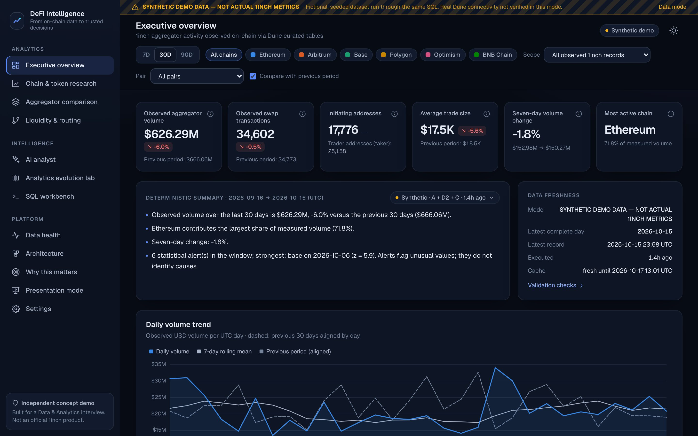
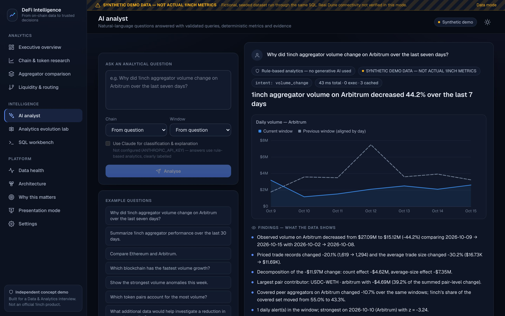
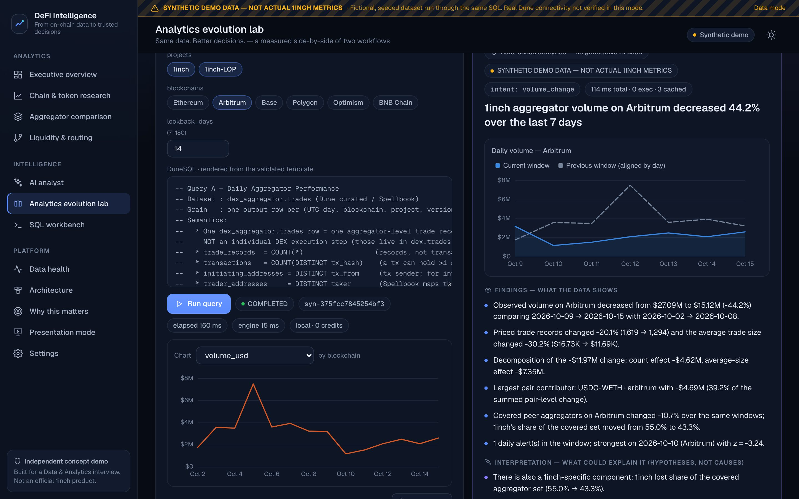
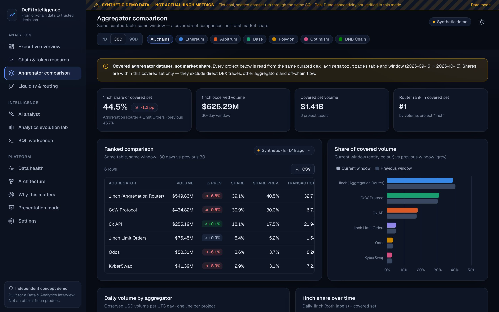
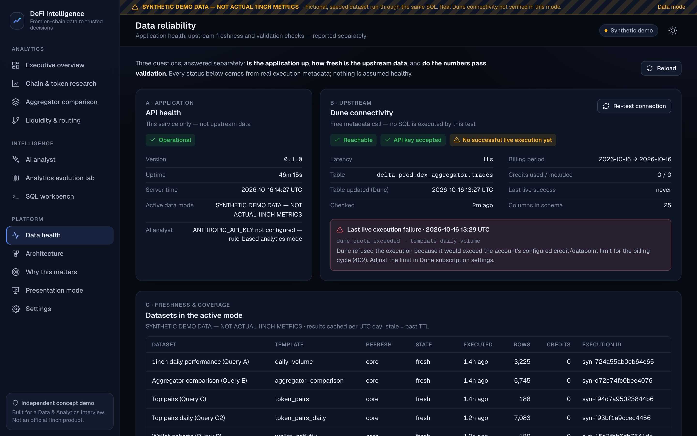
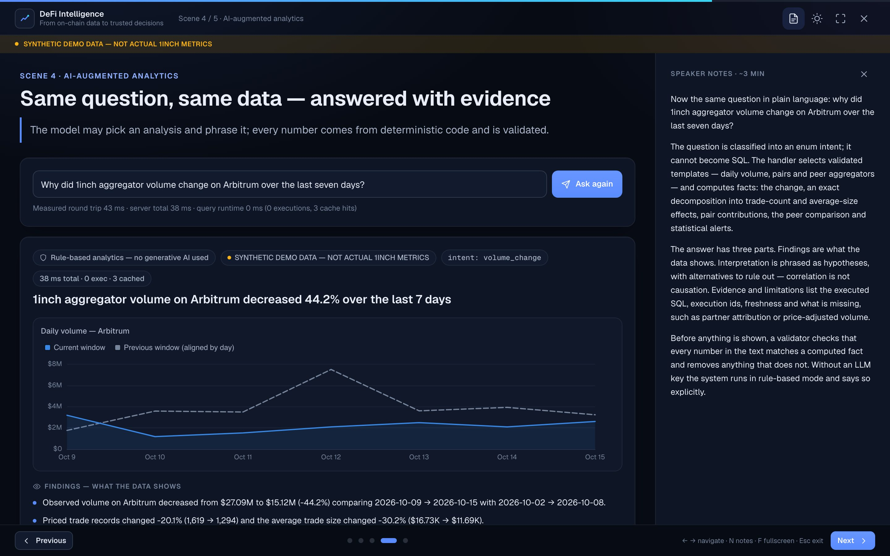
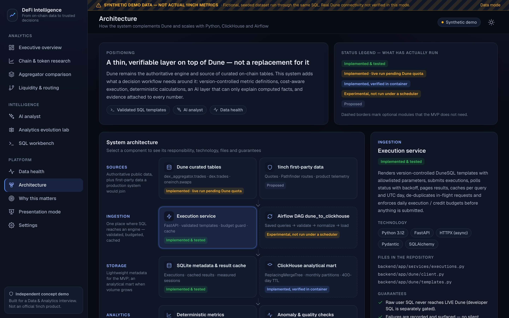
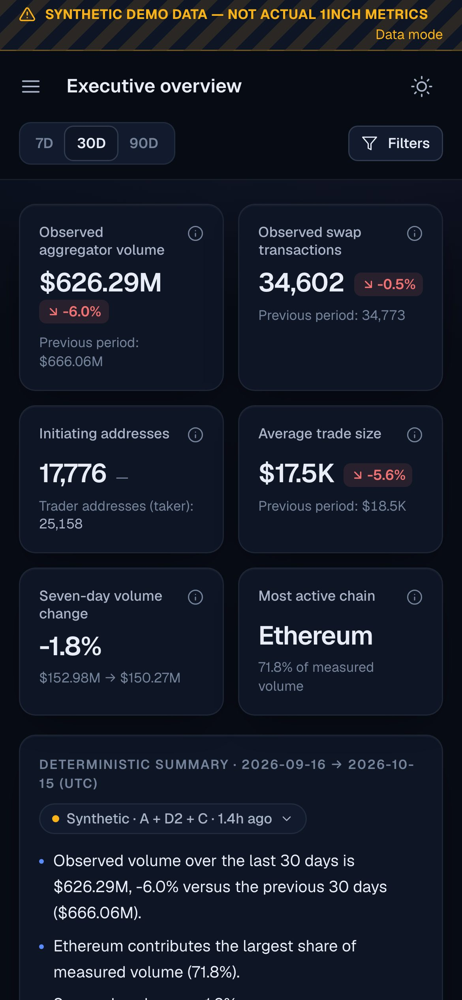
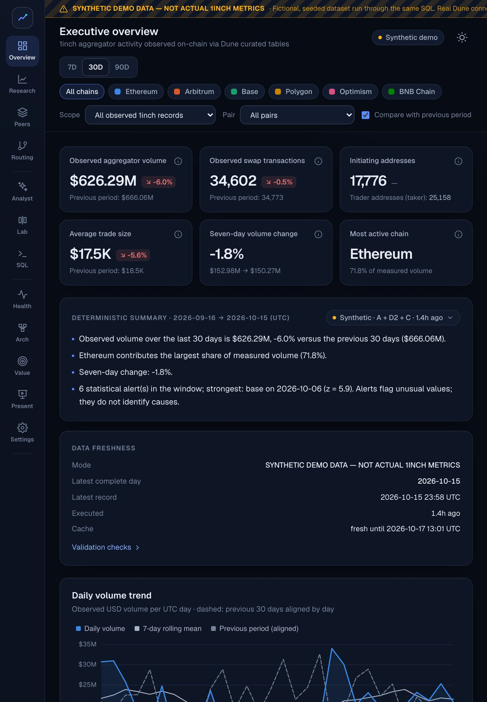

# DeFi Intelligence: from on-chain data to trusted decisions

**Homepage → https://wearetheartmakers.github.io/1inch-defi-intelligence/**

> **Independent concept demo.** Built for a Data & Analytics Lead interview. It is not an official 1inch product and
> is not affiliated with or endorsed by 1inch. The screens below show the bundled **synthetic demo dataset**. In the
> app that data is always labelled "SYNTHETIC DEMO DATA — NOT ACTUAL 1INCH METRICS".

This is a working analytics platform built on top of Dune. It has three parts:

- **Version-controlled DuneSQL**, run through the official Dune API.
- **A provenance-first, multi-chain dashboard.**
- **An AI analyst that can only explain numbers it can prove.**

Every figure traces back to a query, an execution id and a deterministic calculation.

This repository is the **public showcase**: an overview, screenshots and the homepage. The source code lives in the
private core repository, `1inch-defi-intelligence-core`. Access is available on request.

## What it does

| Capability | Highlights |
|---|---|
| Real Dune integration | Execute SQL and saved queries, poll status, fetch paginated results, cancel, retry on rate limits, cache. Credit budgets are enforced before anything is submitted. Keys stay server-side. |
| Validated DuneSQL | 13 templates (daily performance, chains, pairs, wallets, aggregators, anomalies, routing, discovery, quality). Parameters are typed and allowlisted. |
| Dashboard | KPIs, trends, chain distribution, address-keyed token pairs, anomalies and freshness. Filters update every chart and the narrative consistently. |
| Grounded AI analyst | The question is mapped to a validated intent, then to metrics and facts. The explanation is checked by a validator before anything is shown. Answers are split into findings, interpretation and evidence & limitations. |
| Analytics evolution lab | A manual SQL workflow and an AI-assisted workflow run side by side on the same data. Only measured times are recorded, and no productivity multiple is claimed. |
| Data reliability | App health, upstream freshness and validation checks are reported separately. A real Dune error is shown as it is, never hidden. |
| Presentation mode | Five interview scenes with speaker notes. |
| Scale path | An optional Airflow → ClickHouse mart. ClickHouse is verified in a container; the Airflow DAG is experimental. |

## Methodology highlights

- **Records ≠ transactions ≠ addresses.** Distinct counts are computed at the window grain (`GROUPING SETS`) and
  never summed across days or chains.
- **`dex_aggregator.trades` and `dex.trades` are never added together.** A routed swap appears in both.
- **`tx_from` is often a resolver.** In intent-based flows (Fusion, CoW) it is not the user, so trader (`taker`)
  and initiator counts are reported side by side.
- **Second-side limit-order rows** (`evt_index = -1`) are surfaced instead of silently double counted.
- **Anomalies are statistical alerts, not causes.** The method is a log-volume z-score against a trailing
  baseline. The SQL and application implementations are asserted identical.

## Screens

| | |
|---|---|
|  |  |
|  |  |
|  |  |

 &nbsp; 

## Stack

- **Backend:** Python 3.12, FastAPI, Pydantic, pandas, DuckDB, sqlglot, SQLAlchemy, HTTPX, Anthropic SDK.
- **Frontend:** Angular 22 (standalone, signals, zoneless), Tailwind v4, ECharts 6.
- **Testing:** Vitest and Playwright.
- **Optional infrastructure:** ClickHouse and Airflow via Docker Compose.

## Honest status

| Area | Status |
|---|---|
| Dune API integration | Implemented and tested. Auth and schema calls verified live. SQL executions are pending the account's datapoint limit (HTTP 402); no live result is faked. |
| SQL templates | Executed on the synthetic engine. Live coverage verification is pending. |
| UI | Verified at 390 / 820 / 1180 / 1440 px, in dark and light themes. |
| Claude integration | Implemented but not exercised live. Without an API key it runs in a clearly labelled rule-based mode. |
| Automated tests | 202 backend (pytest), 54 end-to-end (Playwright), 20 frontend unit (Vitest), all passing. |

## About this homepage

A static page with no framework:

- **Modern CSS:** OKLCH colour tokens, container queries, and scroll-driven animations (`animation-timeline: view()`)
  with fallbacks.
- **Interaction:** a canvas network background, View Transitions for the theme switch, and pointer spotlights.
- **Accessibility:** respects `prefers-reduced-motion`; responsive across phone, tablet and desktop.

---

© WeAreTheArtMakers. All rights reserved. Content and screenshots are provided for review purposes.
