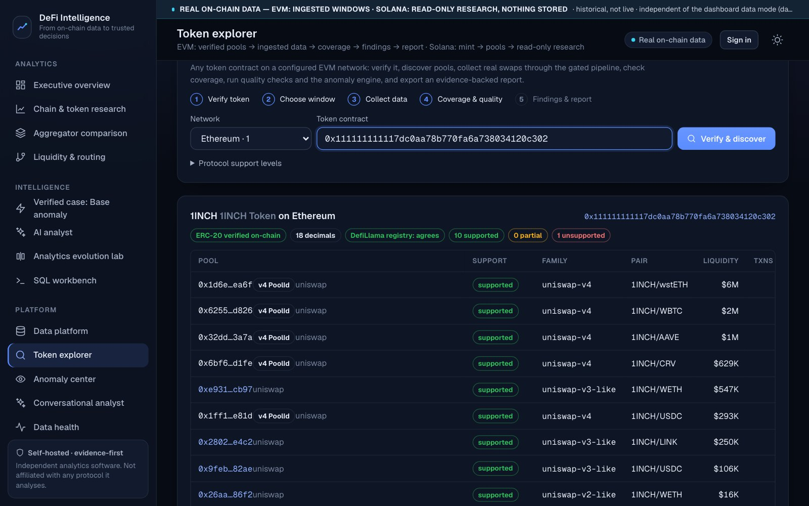
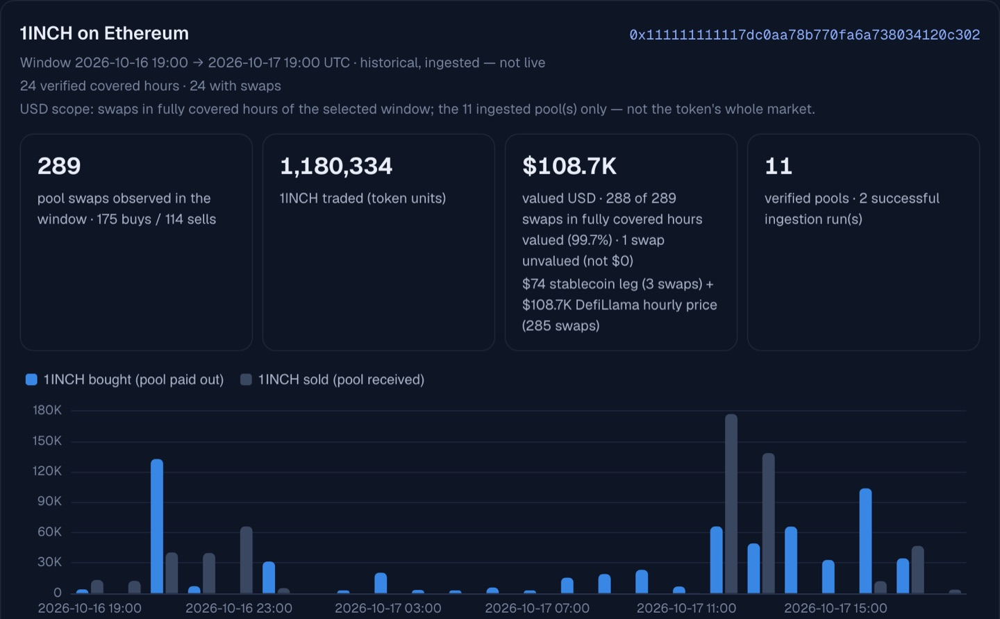
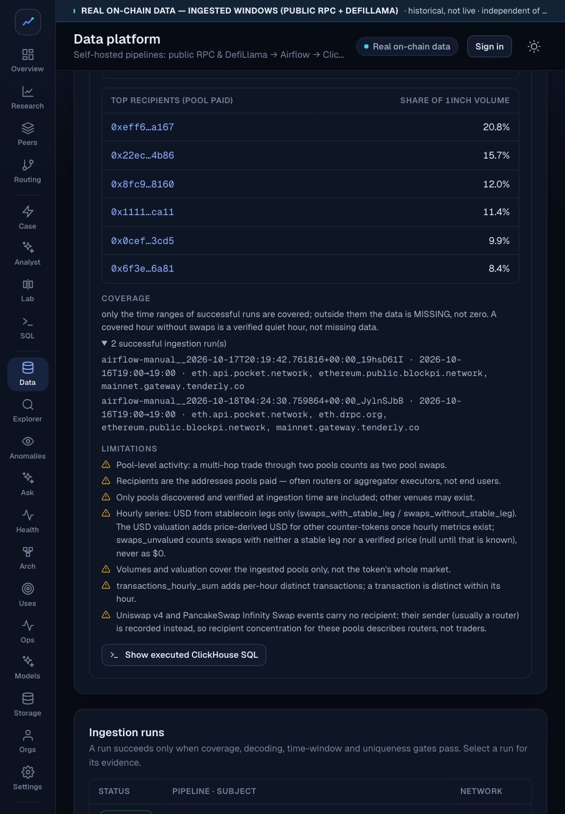
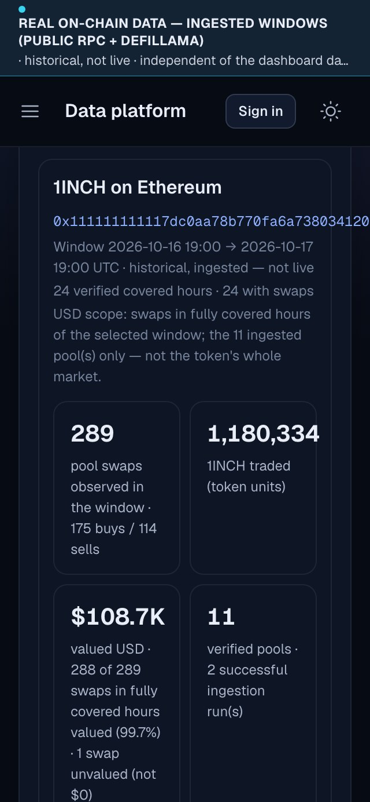
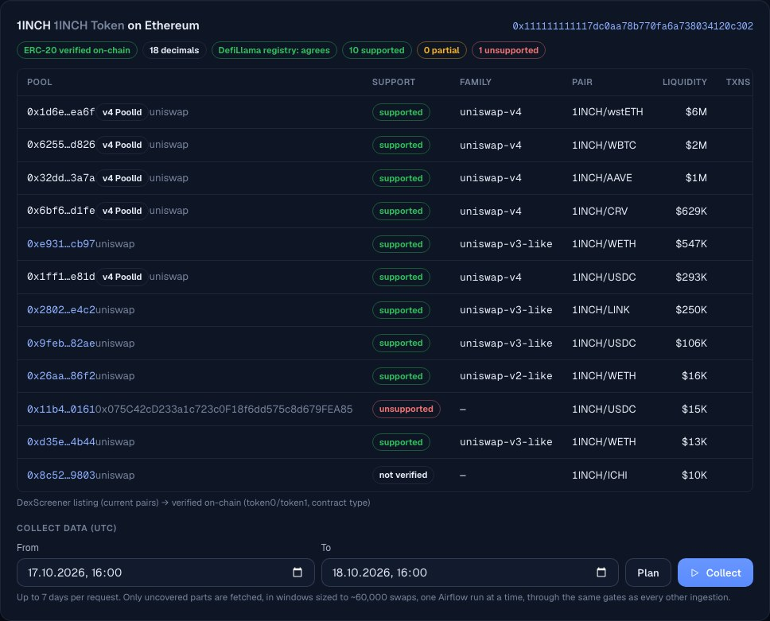
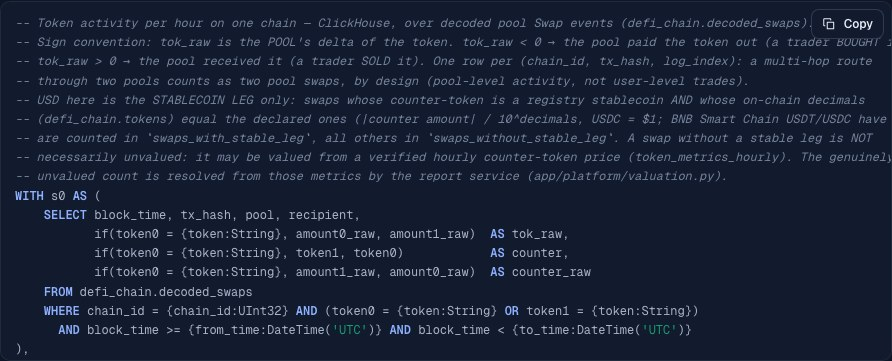
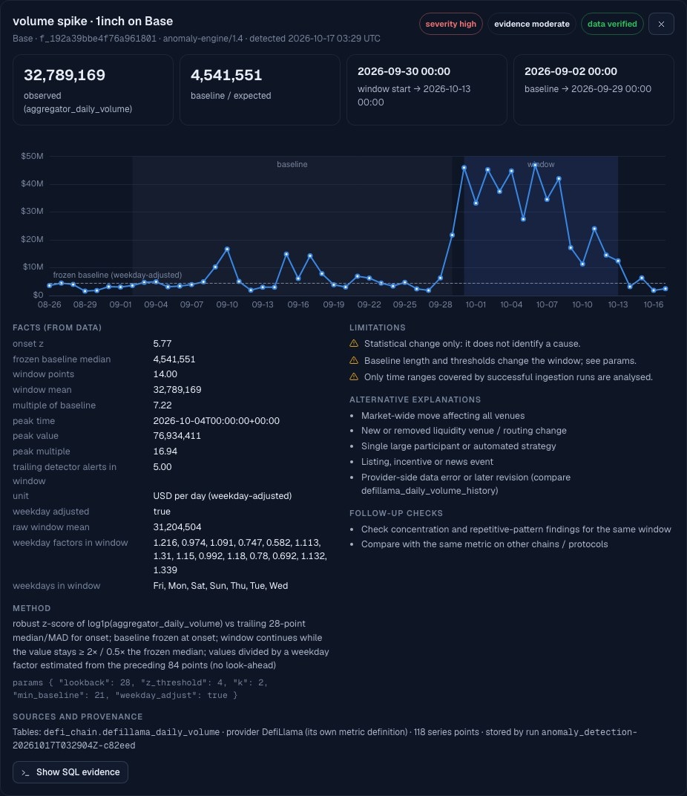

# DeFi Intelligence

**Self-hosted, multi-chain DeFi analytics and evidence-grounded AI research: token exploration, anomaly detection,
reporting and private AI integration.**

Homepage → https://wearetheartmakers.github.io/1inch-defi-intelligence/ · **[Request a Private Pilot](mailto:admin@wearetheartmakers.com?subject=DeFi%20Intelligence%20%E2%80%94%20Private%20Pilot%20Request&body=Company%20%2F%20Organization%3A%0AContact%20person%3A%0ABusiness%20email%3A%0AIntended%20use%20case%3A%0APreferred%20deployment%3A%20Self-hosted%20%2F%20Private%20Server%20%2F%20Enterprise%0APreferred%20AI%3A%20Local%20Models%20%2F%20Claude%20API%20%2F%20OpenAI%20API%20%2F%20Customer-Hosted%0AAdditional%20requirements%3A%0A%0A%28Please%20do%20not%20include%20confidential%20datasets%2C%20API%20credentials%2C%20private%20keys%20or%20passwords.%29%0A)**

DeFi Intelligence is independent software. It is not affiliated with or endorsed by any protocol it analyses.
This repository is the **public showcase**: an overview, screenshots and reviewed example results. The application
source is private. The examples below are **precomputed, reviewed snapshots (generated 2026-10-17; the Ethereum 1INCH case 2026-10-18)**. They are not live
data, and this static page does not connect to any API.

*A responsive web application (desktop, tablet and phone browsers), self-hosted on your own server — not a native mobile app.*

## Who it is for
- **Protocols, DAOs and token teams:** how your token trades across chains and pools, with unusual activity flagged
  against its baseline and the evidence attached.
- **Funds and research desks:** source-backed token and protocol research; every figure carries its coverage,
  valuation method and SQL.
- **Risk, compliance and market-integrity analytics:** anomaly findings for investigation triage, as statistical
  observations with limitations, never accusations.
- **Analytics consultancies:** client-ready reports from verified data on private infrastructure.

## How it works
1. **Verified data:** swaps from public JSON-RPC (or your own endpoints), proven complete per block range,
   cross-checked, and published to ClickHouse only after quality gates pass.
2. **Analytics and findings:** covered-hour metrics, window comparisons, an anomaly engine with frozen baselines, and
   reports that state exactly what they cover.
3. **Evidence-grounded AI:** answers cite the verified facts of each question. Numbers, terminology and claims are
   re-checked, and anything unproven is replaced by a clearly labelled deterministic answer.

## What it does

| Capability | What it means |
|---|---|
| **Verified multi-chain ingestion** | Public JSON-RPC on Ethereum, Base, Arbitrum One, OP Mainnet, BNB Smart Chain and Avalanche C-Chain through Airflow into ClickHouse (BNB Smart Chain: recent windows; Avalanche: verified read-only, not yet ingested). Solana: read-only research, nothing stored. Block coverage is proven per run; empty answers are confirmed by a second provider; timestamps come from block headers; a run is published only when every quality gate passes, idempotently. |
| **Universal token explorer** | Any token contract on a supported network: on-chain identity check plus an independent registry check, pool discovery, decoder support level per pool (supported / partially supported / unsupported), collection of only the missing windows, per-pool coverage, quality checks, anomaly detection and an evidence-backed report. |
| **Receipt-verified decoders** | Uniswap v3-style, Uniswap v2-style (including PancakeSwap v2, LFJ v1 and Pangolin v2), PancakeSwap v3 (its own decoder) and Solidly-style (Velodrome/Aerodrome v2) pools. A family is supported only after ≥ 2 pools on ≥ 2 networks match transaction receipts exactly, including Solidly's fee forwarding. **Uniswap v4** is verified pool by pool instead: six Ethereum 1INCH pools are individually verified and ingestible; other v4 pools and PancakeSwap Infinity CL / Bin pools are verified one by one on request, and pools with native currencies or swap-changing hooks are not supported. |
| **Anomaly intelligence** | Volume, activity and liquidity shifts against a baseline frozen at onset, plus address concentration, buy/sell imbalance, price-volume divergence and repetitive patterns. Every finding carries facts, method, parameters, limitations and alternative explanations, and none is an accusation. |
| **Honest valuation** | USD comes from a stablecoin leg or a verified hourly price within ±15 minutes. Swaps without a verified price are counted as *unvalued*, never as $0. Pool-event volume and transaction-net volume (routing removed) are reported separately. |
| **AI provider options** | **Local models via Ollama** (tested). **Anthropic Claude API** and **OpenAI API** (integrated; optional, off by default; no paid request until an administrator authorises paid use within request, token and budget limits). **Self-hosted OpenAI-compatible servers** such as vLLM, llama.cpp, LM Studio or an organisation gateway (integration options through the same adapter, which is tested against Ollama's OpenAI-compatible endpoint). Every sentence must cite the facts behind its numbers; a rejected answer falls back to a deterministic, evidence-backed one, labelled as such. |
| **Conversational analyst** | Multi-turn, multilingual conversations (tested in English, Turkish and German). Follow-up questions keep the token and topic of the previous turn, and every turn is re-grounded in its own verified facts. |
| **Operations** | One operations view (service health, pipeline runs and failures, freshness per token, quality audits, backups, alerts), measured storage, verified backups with test-restore, a versioned staging archive, separate restartable Airflow services, preflight resource checks, an audit log, organisations and role-based access. |

## Verified research examples (reviewed snapshots)

**1INCH token on Ethereum** (16 Oct 2026 19:00 → 17 Oct 2026 19:00 UTC; 11 ingested pools, including six individually
verified Uniswap v4 pools).

- **Activity:** 289 pool Swap events in 250 distinct transactions, over 24 fully covered hours across all 11 selected
  pools.
- **Valuation:** 288 of 289 swaps valued (99.7%), giving **$108,733.34** of USD-valued pool-event volume. 3 swaps were
  valued from a stablecoin leg and 285 from verified DefiLlama hourly prices. One wstETH swap had no verified hourly
  price and stays unvalued, never counted as $0.
- **Routing:** 28 transactions passed through more than one ingested pool. Pool-event volume (1,180,334 1INCH) is
  therefore higher than transaction-net volume (855,100 1INCH).
- **Findings:** none for this 24-hour window under the existing detection method.
- **Scope:** selected-pool event measurements. This is **not** total 1INCH market volume and **not** transaction-net
  trading volume; other pools, venues and exchanges are not included.

| Pair | Protocol | Fee tier | Swap events |
|---|---|---|---|
| 1INCH / CRV | Uniswap v4 (PoolId 0x6bf6…d1fe) | 1% | 79 |
| 1INCH / AAVE | Uniswap v4 (PoolId 0x32dd…3a7a) | 1% | 50 |
| 1INCH / LINK | Uniswap v3 (0x2802…e4c2) | 0.3% | 47 |
| 1INCH / wstETH | Uniswap v4 (PoolId 0x1d6e…ea6f) | 1% | 39 |
| 1INCH / LINK | Uniswap v4 (PoolId 0x17bc…2958) | 1% | 33 |
| 1INCH / WETH | Uniswap v3 (0xe931…cb97) | 1% | 21 |
| 1INCH / WETH | Uniswap v2 (0x26aa…86f2) | 0.3% | 13 |
| 1INCH / WETH | Uniswap v3 (0xd35e…4b44) | 0.3% | 3 |
| 1INCH / USDC | Uniswap v4 (PoolId 0x1ff1…e81d) | 1% | 2 |
| 1INCH / WBTC | Uniswap v4 (PoolId 0x6255…d826) | 1% | 1 |
| 1INCH / USDC | Uniswap v3 (0x9feb…82ae) | 1% | 1 |
| **11 pools** | **6 Uniswap v4 (204 events), 4 Uniswap v3, 1 Uniswap v2** | | **289** |

**How the six Uniswap v4 pools were verified:**
- **PoolId ↔ PoolKey:** each pool's Initialize event (found on one RPC provider, confirmed by three others) gives its
  PoolKey, and the hash of that key equals the PoolId. All six are hookless 1% pools without native ETH.
- **Two-provider agreement:** the 204 v4 Swap events in this window were fetched independently from two RPC providers.
  Both returned the identical set, and the published rows match it event for event.
- **Sampled receipt reconciliation:** 149 sampled transaction receipts (from this window and earlier blocks) reconciled
  exactly with the PoolManager's token transfers, 24–25 per pool, with 0 mismatches. Not every one of the 204 swaps was
  individually receipt-reconciled.
- **Not automatically supported:** other v4 PoolIds, Uniswap v4 on other networks, pools with hooks that can change swap
  amounts and pools with native ETH each need the same verification first.

This case covers the 1INCH ERC-20 token in selected Ethereum pools. It is separate from the aggregator case on Base
below, which analyses 1inch aggregator volume on another network.

**1INCH on other networks (read-only inventory, 18 Oct 2026).** The token contract was verified on BNB Smart Chain,
Arbitrum One, OP Mainnet and Base, but the current discovery (DexScreener listings, each verified on-chain, with a $10,000
liquidity floor) found no pool there that can be ingested today: on BNB Smart Chain the 12 listed pools were below the
floor; on Arbitrum One and OP Mainnet DexScreener listed no pool, which does not prove that none exists (unlisted pools
are undiscovered, not absent); on Base four Uniswap v4 pools await individual verification and one pool was below the
floor. On Avalanche C-Chain the bridged token's on-chain symbol (1INCH.e) differs from the registry's (1INCH), so its
identity is unresolved and it is not analysed until it has been verified. 1INCH trading on these networks is therefore
not covered; the case above measures the 11 Ethereum pools whose protocol identity was verified when the window was
collected (of 12 listed; the twelfth belonged to an unrecorded fork).

**1inch aggregator volume anomaly on Base** (1 Sep → 15 Oct 2026; aggregator research, separate from 1INCH token trading volume). This is an audited case: every headline
number was re-derived from 3,293,676 decoded swap events, and 150/150 sampled receipts matched.
- Window volume: **$458.56M**. A single automated account accounted for **90.2%** of it.
- Peak: **10.3×** the pre-onset median.
- Volume excluding the identified account: **−15.5%** against its 14-day baseline. The audit corrected this from
  −20.5% after finding a silently empty provider response.
- These are statistical observations; they do not claim intent.

## Screenshots
Real screens from the self-hosted web application on verified on-chain data (captured 2026-10-18).

| | |
|---|---|
|  |  |
|  |  |
|  |  |

## Local model benchmark (reviewed snapshot, 2026-10-17)
Same frozen fact set (10 questions in English, Turkish and German; 8 answered by the model, 2 declined by deterministic
pre-checks), same validators, on a 16 GB laptop:

| Model | Answers accepted by validation | Grounding failures (fell back to deterministic) | Avg latency | Resident memory |
|---|---|---|---|---|
| gemma3:4b | 8 / 8 | 0 | 8.3 s | 2.9 GB |
| qwen3.5:9b | 6 / 8 | 2 | 22.4 s | 5.7 GB |

In release testing on 2026-10-17, gemma3:4b answers to an English question and English and Turkish follow-ups were all
accepted; in a later run a Turkish answer that cited the wrong facts was rejected and replaced by the deterministic
answer, as designed. A benchmark on one machine, not a performance promise; larger models
and GPU servers have not been benchmarked yet.

## Seven networks: what each level means

- **Configured:** all seven networks: public RPC endpoints, explorers and token / pool registries are set up.
- **Read-only research:** token identity, pool discovery and per-pool protocol verification on demand. Nothing is stored.
- **Verified ingestion:** swaps are stored only after per-run coverage proof, two-provider checks and every quality gate.
- **Automatic analysis:** one click from a token to a verified report. In development and not released. It has been tested only in an isolated test environment, not in production.
- **Unsupported protocols:** listed with the reason, never measured.

| Network | Read-only research | Verified ingestion | Automatic analysis | Notes and unsupported protocols |
|---|---|---|---|---|
| Ethereum | Yes | Tested on real data | Not released | Includes six individually verified Uniswap v4 1INCH pools. Uniswap v4 pools with native ETH or swap-changing hooks are not supported; other v4 pools only once individually verified. |
| Base | Yes | Tested on real data | Not released | Four 1INCH Uniswap v4 pools await individual verification. Uniswap v4 pools with native ETH or swap-changing hooks are not supported; other v4 pools only once individually verified. |
| Arbitrum One | Yes | Tested on real data | Not released | Uniswap v4 pools with native ETH or swap-changing hooks are not supported; other v4 pools only once individually verified. |
| OP Mainnet | Yes | Tested on real data | Not released | Uniswap v4 pools with native ETH or swap-changing hooks are not supported; other v4 pools only once individually verified. |
| BNB Smart Chain | Yes | Recent windows | Not released | Selected pools, recent windows only: older windows need two independent archive RPC providers. PancakeSwap Infinity CL / Bin pools with native currencies or swap-changing hooks are not supported; others are verified pool by pool. |
| Avalanche C-Chain | Yes | Not yet | Not available | Pool discovery and protocol verification (LFJ v1, Pangolin v2, Uniswap v3) only. The bridged 1INCH.e token's identity is unresolved. |
| Solana | Yes | Not yet | Not available | Mint verification, Raydium CPMM / CLMM and Orca Whirlpool pool verification and bounded swap research; nothing is stored. Every other program is listed with the reason and never measured. |

## Tested vs. not yet verified
| Capability | Status |
|---|---|
| Ingestion, token explorer, anomaly engine, reports and comparisons on Ethereum, Base, Arbitrum One and OP Mainnet | Tested on real data |
| BNB Smart Chain: verified ingestion and hourly metrics for selected pools; older windows not operationally approved until two independent archive RPC providers are configured | Recent windows tested |
| Avalanche C-Chain: pool discovery and protocol verification | Verified read-only; not yet ingested |
| Solana: mint and Raydium / Orca pool verification, bounded swap research reconciled against token balances | Read-only research; nothing stored |
| Uniswap v4: six individually verified Ethereum 1INCH pools | Tested on real data |
| Other Uniswap v4 pools, on any of the six EVM networks | Verified pool by pool on request |
| PancakeSwap Infinity CL and Bin pools (BNB Smart Chain) | Verified pool by pool; none in production yet |
| Uniswap v4 and Infinity pools with native currencies or hooks that change swap amounts | Not supported |
| PancakeSwap v3 (own decoder, receipt-verified on BNB Smart Chain and Ethereum) | Tested on real data |
| Local models via Ollama, including a live multilingual multi-turn conversation | Tested |
| Self-hosted Docker Compose installation (TLS proxy, first administrator, upgrade and rollback) | Tested on Docker Desktop |
| Organisation roles and isolation of organisation data | Tested |
| Local backups with verified test restore | Tested |
| Live Anthropic Claude API / OpenAI API calls | Not yet verified |
| vLLM on GPU servers | Not yet verified |
| Kubernetes deployment on a single-node test cluster | Validated locally |
| Encrypted S3-compatible backups with isolated restore verification, against local S3-compatible storage | Tested locally |
| Off-site recovery from an independent external S3 destination | Not yet verified |

## Deployment
| Profile | Target | Status |
|---|---|---|
| Business server | Linux with Docker Compose, 32 GB RAM recommended, 50 GB+ persistent storage, optional NVIDIA GPU; only the TLS proxy exposed; your own RPC endpoints supported | Tested on Docker Desktop |
| Local evaluation | ~16 GB machine, small local models, memory guard, automatic ingestion off by default | Tested |
| Enterprise | Kubernetes, separate GPU inference servers; manifests with optional Airflow | Validated on a local single-node cluster (upgrade, rollback, persistence, network policies, backups); production clusters, managed cloud, external TLS ingress and GPU inference nodes not yet validated |

Backups are encrypted before they leave the server. Point them at your own S3-compatible bucket for off-site copies; every backup can be restore-verified in isolation, without modifying production data. Tested end-to-end against local S3-compatible storage; recovery from an independent remote destination has not yet been verified.

These are starting points, not performance promises: capacity depends on the measured hardware.

## Optional integrations
- **Dune Analytics:** optional and off by default. Keys are stored encrypted on the server and tested with free calls
  only. No workflow depends on it.
- **Remote or enterprise AI endpoints:** receive organisation data only when an administrator authorises them.
- **Anthropic / OpenAI:** off by default; no chargeable request is made until an administrator authorises paid use.

## Limitations
- **Analysed scope:** the networks, verified protocol families and individually verified pools listed above, and only
  pools that are discovered and ingested. Other venues are not counted, so no figure here is a token's whole market.
- **Pool-event volume:** a routed trade is counted in every ingested pool it passes through; transaction-net volume is
  reported separately.
- **Time ranges:** the examples above cover historical, ingested windows; nothing here is live streaming data.
- **Findings:** statistical observations. They never establish intent, manipulation or wash trading, and addresses are
  not identified entities.
- **Local AI quality:** depends on the model. The validators reject ungrounded or forbidden statements but do not
  correct grammar.
- **Multi-tenancy:** organisation isolation is enforced and tested for workspaces, reports, members, tokens, settings
  and audit. Ingested public-chain data is shared platform-wide.
- **No advice or guarantees:** DeFi Intelligence is analytics and research software. It is not investment advice, makes
  no promise of trading or investment outcomes, and is not a regulatory certification.

## Private pilot
A pilot is installed on **your own server** and runs in evaluation mode for one organisation.
- **You provide:** a Linux server with Docker (32 GB RAM recommended, 50 GB+ storage), optionally your own RPC endpoints
  and a local or cloud AI model.
- **We never ask for** confidential datasets, API credentials, private keys or passwords.
- **Terms** such as duration, scope and support are agreed individually before a pilot starts.

**[Request a Private Pilot](mailto:admin@wearetheartmakers.com?subject=DeFi%20Intelligence%20%E2%80%94%20Private%20Pilot%20Request&body=Company%20%2F%20Organization%3A%0AContact%20person%3A%0ABusiness%20email%3A%0AIntended%20use%20case%3A%0APreferred%20deployment%3A%20Self-hosted%20%2F%20Private%20Server%20%2F%20Enterprise%0APreferred%20AI%3A%20Local%20Models%20%2F%20Claude%20API%20%2F%20OpenAI%20API%20%2F%20Customer-Hosted%0AAdditional%20requirements%3A%0A%0A%28Please%20do%20not%20include%20confidential%20datasets%2C%20API%20credentials%2C%20private%20keys%20or%20passwords.%29%0A)** (opens a short email template: organisation, contact, use case, preferred
deployment and AI).

Contact: admin@wearetheartmakers.com
